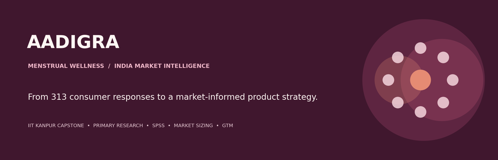
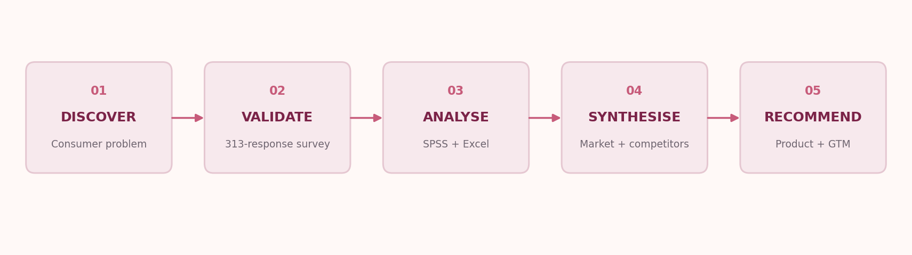
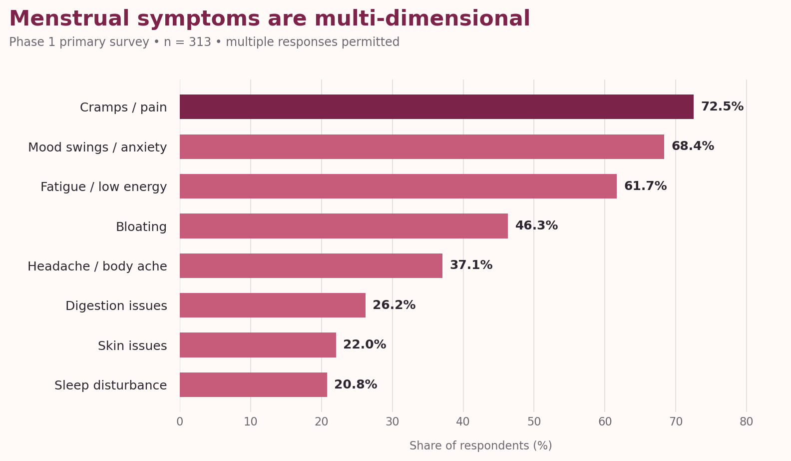
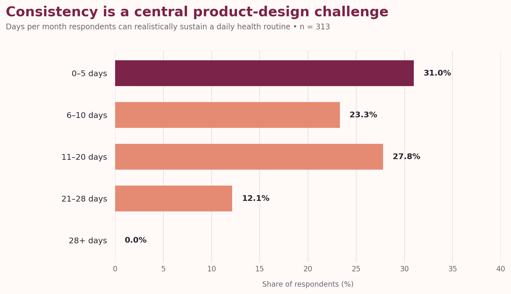
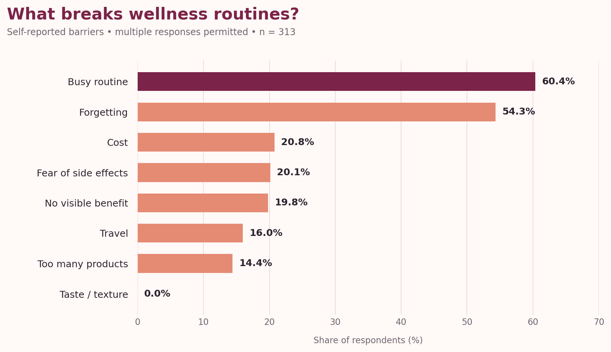
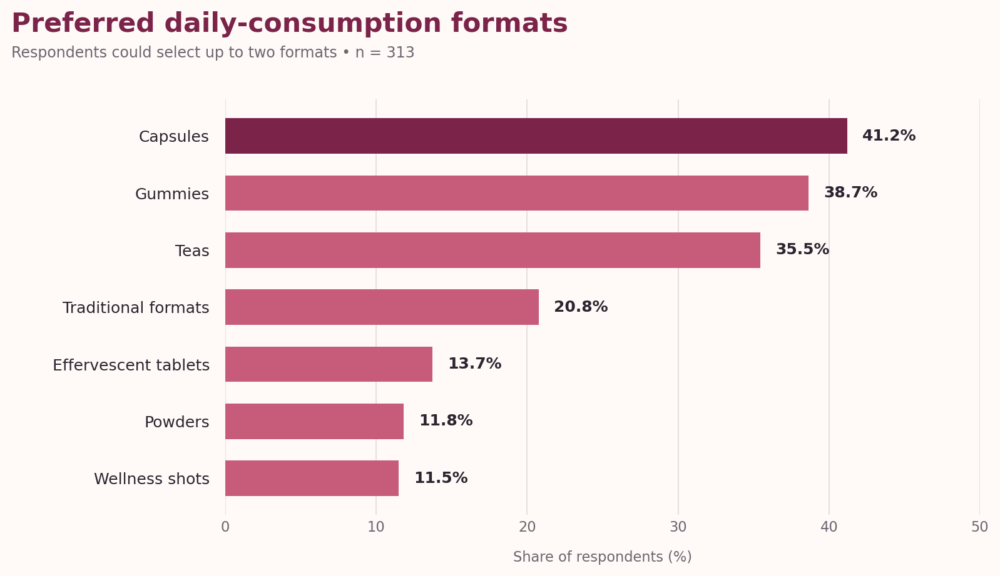
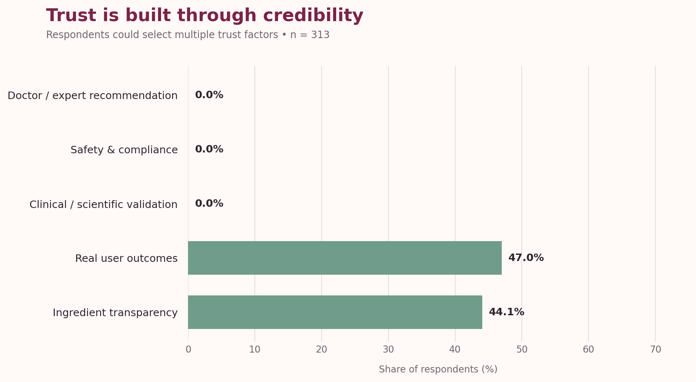

# Aadigra | Menstrual Wellness Market Research

### From consumer research to a market-informed product strategy

**An end-to-end market research and strategy project for Aadigra Pvt. Ltd.**  
IIT Kanpur · Department of Management Sciences · 2026

---

## Contents

- [Project at a glance](#project-at-a-glance)
- [The research question](#the-research-question)
- [Research at a glance](#research-at-a-glance)
- [What the survey revealed](#what-the-survey-revealed)
- [From insight to strategy](#from-insight-to-strategy)
- [Market and competitive analysis](#market-and-competitive-analysis)
- [Research methodology](#research-methodology)
- [My contribution](#my-contribution)
- [Project deliverables](#project-deliverables)
- [Important notes on interpretation](#important-notes-on-interpretation)

## Project at a glance

Aadigra's research project explored the Indian menstrual wellness market: the symptoms consumers experience, the solutions they currently use, the reasons routines break down, and the product attributes that could encourage trust and sustained use.

The work combined a **313-response primary survey** with statistical analysis, consumer segmentation, competitor benchmarking, market sizing, pricing research and go-to-market recommendations.

| | |
|---|---|
| **Client / organisation** | Aadigra Pvt. Ltd. |
| **Academic context** | IIT Kanpur Capstone Project, Department of Management Sciences |
| **Research period** | 2.5-month research engagement; reports dated February 2026 |
| **Primary research** | 313 survey responses |
| **Analysis tools** | Microsoft Excel, IBM SPSS |
| **Research scope** | Consumer behaviour, market opportunity, competition, pricing, product strategy and GTM |

## The research question

Menstrual discomfort is not experienced as a single symptom. The survey points to a combination of physical and emotional experiences, while also highlighting a gap between the need for support and the ability to maintain a consistent wellness routine.

The central question was:

> **How might a menstrual wellness offering fit real consumer routines, earn trust, and address the multi-dimensional nature of menstrual discomfort?**

The project examined five connected areas:

1. **Need:** Which symptoms are most frequently reported, and how much do they disrupt everyday life?
2. **Current behaviour:** What do respondents use today, and how satisfied are they?
3. **Adherence:** What prevents consumers from maintaining a wellness routine?
4. **Product-market fit signals:** Which formats, personalisation features, price points and trust signals resonate?
5. **Commercial strategy:** Where are the competitive gaps, and how could a differentiated offer enter the market?

## Research at a glance

| **313** | **93.6%** | **71.2%** | **54.3%** |
|:---:|:---:|:---:|:---:|
| Survey responses | Reported at least one recurring symptom | Rated daily-life impact 3–5 out of 5 | Could sustain a routine for 10 days/month or fewer |

These are **survey-sample findings**, not estimates of national prevalence. The percentages below use the 313-response workbook as the denominator unless noted otherwise.

## What the survey revealed

### 1. The symptom burden is multi-dimensional

The most frequently reported symptoms were cramps or pain, mood swings or anxiety, and fatigue. Respondents could select multiple symptoms.

**What this suggests:** Product positioning based only on cramps may miss important parts of the consumer experience. Mood, energy and bloating also feature prominently in the responses.

### 2. Routine adherence is a meaningful design challenge

Only 17.9% of respondents said they could realistically follow a daily health routine for 21 or more days in a month. More than half reported a realistic routine duration of 10 days or fewer.

The most frequently selected barriers were a busy routine and forgetting.

**What this suggests:** Convenience, habit formation, simple usage instructions and a low-friction consumption experience deserve as much attention as the product formulation.

### 3. Format preferences point towards convenience

Respondents were asked which formats they could realistically consume daily (up to two selections).

Capsules, gummies and teas emerged as the most frequently selected formats in the response data. The research also assessed alternative formats, including effervescent tablets, powders and wellness shots.

**Strategic implication explored in the research:** Prioritise easy-to-adopt formats and evaluate format choice as a potential lever for repeat use—not simply as a packaging decision.

### 4. Trust is a product and go-to-market requirement

Doctor or expert recommendation was the most frequently selected trust factor, followed by safety and compliance assurance and clinical or scientific validation.

**What this suggests:** Credibility should be designed into the proposition through transparent ingredients, responsible claims, safety information, credible expert engagement and substantiated outcomes.

### 5. Personalisation has a meaningful interest signal

The Phase 1 analysis reported:

- **75.4%** agreed (rating 4 or 5) that different menstrual-cycle phases create different needs.
- **50.6%** were classified as highly open / action-ready for personalised wellness in the presentation's analysis.

These are attitudinal survey signals, not proof of purchase intent or clinical effectiveness. The research explored how a phase-aware proposition could be made understandable without adding complexity to the user's daily routine.

## From insight to strategy

The research translated consumer evidence into a set of product and commercial hypotheses.

| Research signal | Strategic response explored |
|---|---|
| Multiple symptoms are commonly reported | Consider a broader menstrual wellness proposition rather than a single-symptom message |
| Busy routines and forgetting are common barriers | Reduce usage friction; make the routine simple and easy to remember |
| Capsules, gummies and teas lead format selections | Prioritise familiar, convenient formats for further product validation |
| Doctor recommendation and safety are leading trust factors | Build a trust architecture around expert credibility, safety and transparent communication |
| Interest exists in phase-specific support | Explore personalisation while keeping the consumer experience simple |
| Spending comfort varies across respondents and locations | Test entry, mid-premium and premium price architecture rather than assuming one price fits all |

### Consumer mindsets identified in the Phase 1 synthesis

The presentation grouped observed patterns into three working mindsets. These are analytical personas derived from the survey—not validated clinical or population segments.

- **The Believer — personalisation-oriented:** already receptive to cycle-aware wellness; needs credible evidence and clear explanation.
- **The Quitter — routine-fragile:** faces consistency barriers; needs a simple, low-effort product experience.
- **The Validator — trust-led:** has a higher evidence threshold; needs transparent ingredients, safety information and credible recommendations.

### Pricing and launch hypotheses

The research explored a tiered pricing architecture, including an accessible entry proposition, a mid-premium core offer and a more personalised premium tier. It also examined digital-first distribution, marketplaces, D2C, pharmacy and modern-trade pathways.

These were **recommendations and hypotheses for validation**, not evidence of a launched product, realised sales or proven unit economics.

## Market and competitive analysis

The Phase 2 work extended beyond the primary survey and covered:

- Bottom-up TAM, SAM and SOM modelling
- Competitive landscape and brand-level benchmarking
- Product format and positioning gaps
- Price points and willingness-to-pay patterns
- Channel economics and distribution options
- Marketing, retention and launch milestones
- Regulatory and labelling considerations for the category

**Market-sizing caution:** the working Phase 2 documents contain different population filters and market-sizing scenarios. For that reason, this README does not present one headline TAM/SAM/SOM figure as a settled market fact. The underlying reports should be reviewed together, assumptions reconciled, and external inputs refreshed before the estimates are used in an investor or commercial decision.

## Research methodology

| Workstream | What was done |
|---|---|
| Primary research | Structured survey; 313 completed responses in the supplied workbook |
| Descriptive analysis | Frequency distributions and response-pattern analysis |
| Cross-tabulation | Explored differences by age group, city type, spending comfort and trust factors |
| Statistical analysis | SPSS outputs included cross-tabulations and chi-square tests; the Phase 1 synthesis also reports factor-analysis findings |
| Market research | Market sizing, competitor profiles, pricing benchmarks and category/format analysis |
| Strategy synthesis | Product, pricing, trust, distribution, marketing and retention recommendations |

### Analytical boundaries

- The survey is a sample of 313 respondents; it should not be treated as a nationally representative study unless the sampling design supports that claim.
- Multi-select questions can sum to more than 100%.
- Associations in cross-tabulations do not establish causation.
- Market-size outputs depend on assumptions and secondary-source inputs; they are scenarios, not audited market measurements.
- Product recommendations require further consumer, formulation, regulatory and commercial validation.

## My contribution

As part of the IIT Kanpur capstone engagement, I worked on the end-to-end market research study for Aadigra. The work covered:

- Structuring and conducting the market research study
- Analysing 313 primary survey responses
- Working with Excel and SPSS outputs to interpret consumer behaviour
- Developing consumer insights and segment-level implications
- Building market-sizing scenarios and competitor analysis
- Translating findings into product, pricing, positioning and go-to-market recommendations
- Synthesising the findings into a market research report and presentation

Aadigra Private Limited issued a Certificate of Appreciation recognising the research contribution and its relevance to the organisation's product development, market strategy and institutional engagements.

## Project deliverables

The project work produced the following artefacts:

- **Primary survey dataset:** 313-response workbook
- **Phase 1 synthesis:** survey insights, behavioural patterns and strategic implications
- **SPSS outputs:** cross-tabulations and statistical output documents
- **Phase 2 market research:** market sizing, competitive landscape, pricing, channels and regulatory considerations
- **Final presentation:** synthesis of consumer insights and strategic recommendations

> **Repository hygiene and confidentiality:** Some source documents are marked confidential, and the workbook contains respondent-level survey records. Before keeping this repository public, confirm Aadigra's permission to publish the reports and certificate, and remove or anonymise respondent-level data. Prefer publishing aggregate charts and an approved, redacted report over raw response records.

## Important notes on interpretation

This project is a **market research and strategy study**. It does not establish that any product is clinically effective, safe for a particular individual, or approved for a medical claim. Any formulation, ingredient, health claim, labelling or advertising decision must undergo appropriate expert, regulatory and legal review.

---

**Aadigra — Origin of Good Health**  
*Researching the need. Understanding the consumer. Informing the strategy.*

IIT Kanpur Capstone Project · 2026

